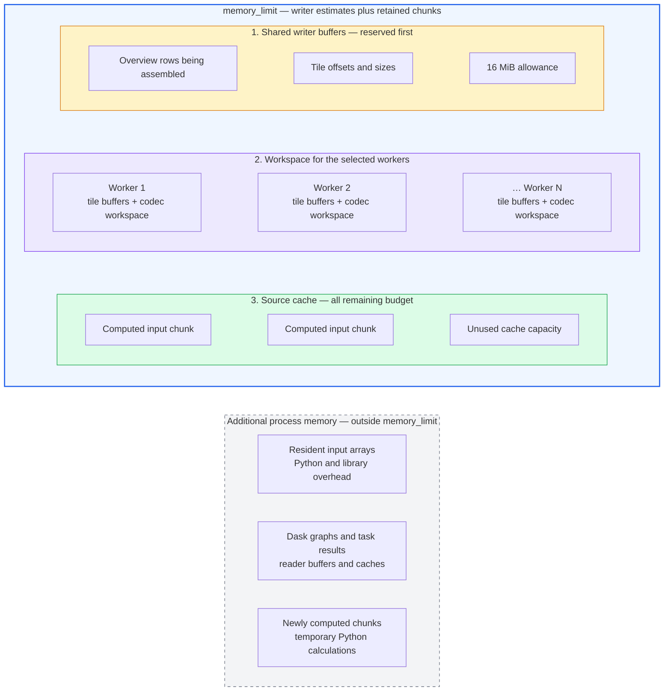
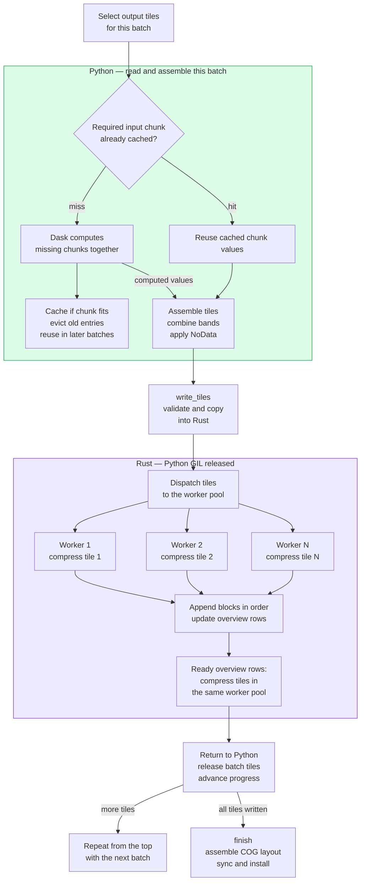

# Architecture

`write_cog()` reads or computes input chunks, assembles a small batch of output
tiles, and sends that batch to Rust for compression and overview generation.
Python coordinates the batches; Rust writes the COG. The caller opens the input
with xarray.

## Memory budget

`memory_limit` is specified in MiB, with a default of
512. Python converts it to bytes before the native writer divides it into three
parts, before reading pixels:



The boxes represent accounting categories, not preallocated memory or sequential
stages. Their sizes are not to scale. Writer buffers and cached chunks coexist
throughout the export. **`memory_limit` is not a cap on total process memory.**

The calculation in [`src/python.rs`](../src/python.rs) is:

```text
budget_bytes = memory_limit × 1,048,576
full_tile_bytes = tile_size × tile_size × bands × bytes_per_sample
shared_writer_estimate = overview_buffers + tile_indexes + 16 MiB
workspace_per_worker = 6 × full_tile_bytes + 1 MiB
source_cache_budget = budget_bytes − shared_writer_estimate
                     − workers × workspace_per_worker
```

Overview buffers hold the tile rows currently being assembled at each overview
level, rather than complete overview images. Average resampling also needs sums
and counts. The index estimate allows 256 bytes per base or overview tile. The
worker estimate covers the Python tile batch, Rust-owned copies, edge padding,
serialized samples, compressed-buffer capacity and codec workspace.

For the benchmark raster—8192×8192 pixels, three Float32 bands, 512×512 tiles,
nearest overviews at 2/4/8/16, four workers and `memory_limit=512` (512 MiB)—the split is:

| Budget component | Size |
|---|---:|
| Shared writer estimate | 61.1 MiB |
| Worker 1 workspace | 19 MiB |
| Worker 2 workspace | 19 MiB |
| Worker 3 workspace | 19 MiB |
| Worker 4 workspace | 19 MiB |
| Source cache | 374.9 MiB |
| **Total** | **512 MiB** |

Each full tile contains 3 MiB of samples; each worker therefore reserves
`6 × 3 + 1 = 19 MiB`. Table entries are rounded. More workers
leave less room for cached chunks.

An explicit `num_threads` is a ceiling. The writer reduces it to fit the memory
budget and the number of tile columns. Automatic selection also considers
available CPUs and leaves at least half the budget remaining after shared writer
buffers for caching, unless even one worker needs more. The maximum batch size
equals the selected worker count. If the shared estimate and one worker cannot
fit, the export fails before reading pixels.

## Cache timing and parallel work

The following diagram follows one batch of a Dask-backed input. Output tiles are
visited from left to right, then top to bottom. A batch contains at most one tile
per Rust worker and never crosses an output tile-row boundary.



**Reading and Rust compression happen in separate phases.** Python waits for
`write_tiles()` to return before starting the next batch; there is no background
read queue. Base-tile compression runs in parallel, as does compression of ready
overview tiles. Appending blocks, accumulating overview samples and final file
assembly are ordered work, so increasing workers does not accelerate every step.
Dask's scheduler and worker settings are independent of `num_threads`.

The export-local cache in [`python/xarray_cog/_source.py`](../python/xarray_cog/_source.py)
retains only the final NumPy results of the input array's declared Dask chunks.
A chunk can serve several output tiles, and chunks spanning multiple bands can
serve those bands too. Dataset variables are computed separately. Dask manages
graph optimization and can share dependencies within a batch; intermediate task
results are not retained between batches or variables. Rechunking and shared
upstream calculations can therefore cause repeated work.

Each retained chunk is an owned copy, charged its array size plus 512 bytes for
bookkeeping. A cache hit marks it as recently used. When a new chunk fits but
space is short, the cache evicts the least recently used entries. Chunks larger
than the entire cache bypass retention. Missing chunks computed for the current
batch stay live until tile assembly finishes, even if they cannot be retained;
this temporary working memory is outside the retained-cache budget. Evicted
chunks are computed again when needed. The cache is cleared when export succeeds,
fails or is interrupted.

For non-Dask inputs, the reader uses xarray's `preferred_chunks` encoding metadata
when available and a decoded chunk fits the cache. Otherwise it reads tile-sized
slices directly. Ordinary resident NumPy arrays use this direct slicing path.

## Output lifecycle and code ownership

[`python/xarray_cog/__init__.py`](../python/xarray_cog/__init__.py) validates dimensions,
regular pixel-center grids, CRS, dtype and NoData; normalizes axis order; and
controls the batch loop. It does not open stores or decode scale/offset again.

[`src/python.rs`](../src/python.rs) exposes the private `NativeWriter` context
manager. It plans memory and workers, validates batch shapes and dtypes, and
copies tiles before releasing the GIL so workers only access Rust-owned data.

[`src/cog/pyramid.rs`](../src/cog/pyramid.rs) manages compression, overview rows,
block indexes and output ordering. Compressed blocks are spooled to temporary
disk, separate from the memory budget. `finish()` writes the final TIFF layout
and copies those blocks in COG order; it does not build a complete uncompressed
intermediate TIFF. The destination is installed atomically after synchronization.
Closing an unfinished writer releases temporary files and the worker pool; native
write or finalization errors close it immediately.

Optional progress advances after each completed batch, shows finalization during
`finish()`, and reports success only after the destination is installed.
